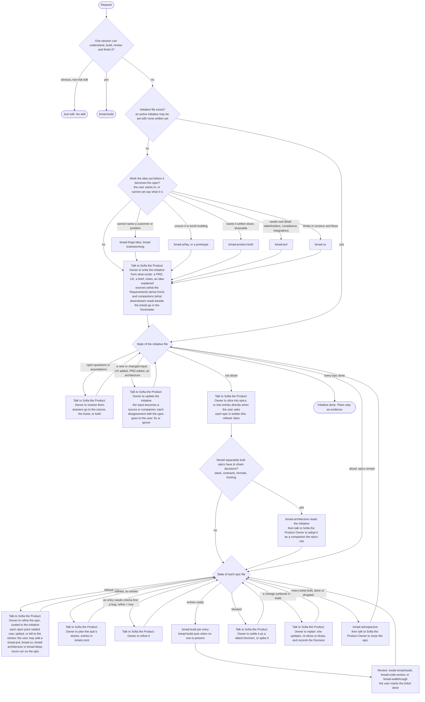

# BMad Method knowledge

This document covers the skills of the `method` module: what each one gives the user, when to recommend it, and what to offer next.

## How the method works

The method turns an intent of any size into working software. Recommend the smallest path that safely fits the work; never march the user through every skill. A project may hold only some of these skills: recommend from what is installed, and say plainly when a step has no installed skill rather than inventing a substitute.

**The ticket is the spec.** The initiative, epic or story file is the spec at its level. Every skill that works on a ticket reads it first and in full and trusts it; its `sources:` are re-read only by Sofia when she updates it, and a `companions:` file only where the ticket points. Talk to Sofia the Product Owner (`bmad-agent-po`) to fill its Requirements from whatever the user has (a PRD, a brief, notes, a transcript), keep it in step with its sources, and slice from it.

The four phases are analysis (ideation, research, is it worth building), planning (what exactly, and in what slices), implementation (build it), and validation (is it right). They describe what kind of help a skill gives. They are not a mandatory sequence to complete.

Project size decides how many build sessions the work needs. Stakes decide how heavy the planning gets. A large hobby project keeps planning light; a small change to a regulated system may not.

## More detail

This document should be enough to route the user and say what to do next. Each topic file below sits in this folder and goes deeper on one subject. Read one only when the question is about that subject, using the path the knowledge script lists for it.

| Topic file | Read when the user asks about |
|---|---|
| `help/analysis-skills.md` | `bmad-product-brief` or `bmad-prfaq` in depth: what each gives, when to pick it, when not to, how they relate. |
| `help/planning-skills.md` | `bmad-agent-po` (Sofia), `bmad-prd`, `bmad-ux`, `bmad-architecture` in depth. |
| `help/implementation-skills.md` | `bmad-build` or `bmad-build-auto` in depth. |
| `help/validation-skills.md` | `bmad-code-review`, `bmad-walkthrough`, `bmad-qa-generate-e2e-tests`, or `bmad-retrospective` in depth. |
| `help/prototyping.md` | Prototyping or vibe coding first, what a prototype is good for (worth doing, feasibility, complexity, unknowns), non-engineers prototyping, what to do with a prototype afterwards, whether planning still matters after a good first version. |
| `help/existing-codebase.md` | Using BMad on an inherited, brownfield, or long-lived codebase. |
| `help/preparing-a-repo-for-agents.md` | Getting a codebase ready for agentic coding, inconsistent agent output, how much documentation to keep (small ADRs, not heavy docs), regular refactoring, holding quality over time. |
| `help/artifact-lifetime.md` | Whether to keep PRDs, specs, stories, and build records after the work is done, archiving, closing out an epic, keeping old plans from misleading agents. |
| `help/monorepo-and-polyrepo.md` | Where to install BMad and keep planning when work spans one repository or several; the workspace layout for a poly repo. |
| `help/working-in-an-organization.md` | A team or enterprise: an existing PRD, Jira or another tracker, approvals and sign-off, document owners, several engineers in parallel, requirements changing mid-flight. |
| `help/ticketing-and-epics.md` | How Sofia's ticket tree works (initiatives, planning an epic's stories, the breakdown, building from an entry, refining), plan status, review, and retrospective. |
| `help/ticketing-setup.md` | Setting up and driving the ticket tree with Sofia: the store, several repos, trackers, the phrases to say, the hand-off to `bmad-build`. |
| `help/unattended-builds.md` | `bmad-build-auto`, building stories with no human present, a blocked run and how to retry, what to check after a run. |
| `help/review-choices.md` | Review depth, skipping review, another review pass, when to stop, slow reviews, customizing review. |
| `help/project-context.md` | `bmad-project-context` in depth: what belongs in `AGENTS.md`, why the block is small, its intents, removing a rule. |

## Routing

Every "what next" is answered by the state of the spec at its altitude: the initiative file, then each epic file. Upstream skills exist to feed it.

Rules the diagram leans on:

- The shaping skills feed each other before they feed the spec: a brief or PRFAQ before a PRD when the requirements still need drawing out; `bmad-ux` before or after a PRD, and it may lead on its own; a PRFAQ verdict with serious gaps is addressed before anything else. Sofia the Product Owner takes more than one input.
- A prototype fits anywhere before the initiative file, and suits enterprise work, hobby work, and non-engineers; a throwaway needs no skill. Thrown away, talk to Sofia the Product Owner to write the initiative from its notes; kept, it is an existing codebase (`help/prototyping.md`).
- Risk, unclear requirements, architectural reach, or several people push work up from one session even when it is small.
- An epic file with no `refined` key counts as refined.
- Mid-path, recommend the next unfinished step of the route the user is on, not a restart. After a change, work resumes at the earliest affected step; unaffected work is not replayed.
- After `bmad-build`: open a PR, or `bmad-qa-generate-e2e-tests` when end-to-end coverage is wanted. The work is complete when the intent is satisfied, its chosen checks pass, and no chosen review leaves material findings open, not when every skill has run.

## Match the situation

Situations the diagram does not settle.

| The user says or has | Recommend | Because |
|---|---|---|
| "Create a spec", "write the initiative", "distill this PRD", "slice this", "tickets", "what's ready", "where are we", "this changed, what now", "ask Sofia", "the product owner" | Talk to Sofia the Product Owner (`bmad-agent-po`) to do what the phrase says | Each phrase dispatches to one of her capabilities (SPEC, TICKETS, REFINE, BOARD, VALIDATE, REPLAN, STORE); no menu is shown. |
| One bug or story to track, with no epic to hold it | Talk to Sofia the Product Owner to write it as a `backlog/` ticket, or an entry in the epic the user names | Standalone leaves live in `backlog/`, are refined first, and build like any entry. |
| The work is more than one initiative's worth | Talk to Sofia the Product Owner to propose a parent initiative | The parent is an ordinary initiative whose breakdown lists child initiatives in build order; each child keeps initiative, epic and story. Set the active initiative to the child being worked, or to the parent to see the whole. |
| Work spans several repositories | Install BMad at a workspace root that holds them all, with planning kept there | One session then reaches the plan and every project (`help/monorepo-and-polyrepo.md`). |
| "How do I get my repo ready for AI agents?", or agents keep producing inconsistent work | Consistent patterns, a good initial `AGENTS.md`, end-to-end tests, and cleanup first when quality is low | Agents copy what they find (`help/preparing-a-repo-for-agents.md`). |
| An inherited or brownfield codebase | A small `bmad-build` change first; `bmad-project-context` and `bmad-walkthrough` as needed | No up-front documentation pass is required (`help/existing-codebase.md`). |
| A team with an existing PRD, a tracker, approvals, or several engineers | The full path only when approvers, parallel teams, or required documents call for it | The existing PRD is input, each document has one owner, and sign-off attaches to skill results (`help/working-in-an-organization.md`). |
| Wants tickets or a tracker (Jira, Linear, GitHub) as the record | Talk to Sofia the Product Owner to connect it | Tickets are the board. |
| A v6 project (`epics.md`, `sprint-status.yaml`, dated folders under the planning folder) that wants the v7 layout | `bmad migrate method`, before anything else | The module ships `migration-1.toml`: the rules for turning the planning folder into an initiative, moving document folders into it whole, and turning epics and sprint status into a ticket tree. Unrecognized files outside the planning folder stay where they are. The `bmad` skill plans it with the user, then performs it. |
| `tickets.py` stops with an error naming `bmad migrate`, or `tickets.toml` or epic folders sit directly in an initiative folder | `bmad migrate method` | The module ships `migration-2.toml`: it moves each initiative's and epic's breakdown into a `tickets/` folder inside it and rewrites the paths that pointed at the moved files. |

## The skills

One line per skill: what it is for and what it writes. Paths are in the active initiative's folder, `{output_folder}/{active_initiative}/`, or in `{output_folder}/` when none is active; each document is a `<type>-<slug>/` folder holding `<type>-<slug>.md`. A `bmad-prd`, `bmad-ux` or `bmad-architecture` run on an epic lands in the epic's folder instead, and Sofia adopts it as the epic's companion. Each initiative's and epic's breakdown sits in a `tickets/` folder inside it. With no active initiative, `bmad-agent-po` offers to create one; the other planning skills hand off to the `bmad` skill to set one. Showing, switching, creating, or clearing the active initiative is a `bmad` request. `planning_artifacts` and `implementation_artifacts` are no longer read.

| Skill | For | Writes |
|---|---|---|
| **Analysis** (`help/analysis-skills.md`) | | |
| `bmad-product-brief` | A 1-2 page brief of a product the user believes in. Lighter than a PRD, sharper than a hand-written intent file. It does not judge the idea. | `brief-<slug>/brief-<slug>.md` |
| `bmad-prfaq` | Tests whether a concept survives scrutiny: press release, hard FAQs, researched claims, a verdict. | `prfaq-<slug>/prfaq-<slug>.md`, plus `-distillate.md` beside it |
| **Planning** (`help/planning-skills.md`) | | |
| `bmad-agent-po` | Sofia the Product Owner. Writes a ticket's Requirements and Constraints from any input, with a stable `R<n>` id per line naming its source, naming the gaps and walking them with the user, or recording each as an Open question line, when the input is sparse, and updates them when the input changes. Slices initiatives into thin epics and epics into stories, refines an epic or a story, runs the board (start, block, close, drop), validates, replans a change mid-flight, and connects a tracker. Stories are entries in `tickets.toml`; a file is written only when one is reviewed, refined, or published. A bug is a `backlog/` file or an entry in its epic. | The ticket file, with `.memlog.md` and companions beside it; the ticket tree under `{output_folder}/{active_initiative}/`, plus `{output_folder}/backlog/` |
| `bmad-prd` | Coaches detailed requirements out of the user, sized to the stakes. Also updates and validates a PRD. | `prd-<slug>/prd-<slug>.md` |
| `bmad-ux` | How the product looks and works. May lead, follow, or stand alone. Can produce mocks and wireframes. | `ux-<slug>/` with `DESIGN.md`, `EXPERIENCE.md`, and `ux-<slug>.md` naming them |
| `bmad-architecture` | Settles only the decisions that keep separately built parts consistent. Coaches a user with no architecture knowledge, recommends a current starter, and covers hosting and deployment. | `architecture-<slug>/architecture-<slug>.md` |
| **Implementation** (`help/implementation-skills.md`) | | |
| `bmad-build` | One session of delivery: clarifies intent, plans, implements, reviews, commits. The default for any real change. Takes free text, a ticket from the tree (nothing means the next ready one), or any file as intent. Reads a ticket in full with its epic. | A ticket's plan beside `tickets.toml`, or `plan-<slug>.md`; `deferred-work.md` |
| `bmad-build-auto` | One unattended build of one ticket, dispatched by a loop or script. Never for attended work. | The same plans as `bmad-build` |
| **Validation** (`help/validation-skills.md`) | | |
| `bmad-code-review` | Agent review of any diff, PR, or branch, with triaged findings; with no argument it offers the tickets in review. Redundant right after a thorough `bmad-build` review of the same change. | A dated block in the plan's `## Code Review` section, or chat |
| `bmad-walkthrough` | The human reviews a change block by block, guided. Also a way to learn unfamiliar code. | `walkthrough-<slug>/` with the narrative and a `-log.md` |
| `bmad-qa-generate-e2e-tests` | API and end-to-end tests for features that already exist. | Tests where the project keeps its end-to-end tests; the report is in chat |
| `bmad-retrospective` | Judges a finished epic folder in the ticket tree as a whole against its Done when. | `epic-<slug>-retrospective.md` in the epic folder, plus each approved `adr-<decision-slug>.md` beside the code it governs, or in the decisions folder when system-wide |
| **Any time** (`help/project-context.md`) | | |
| `bmad-project-context` | Keeps a small, verified block of rules for agents. Use it when an agent got something wrong in this repo, a repo has no usable `AGENTS.md`, or the stack was just decided. It gives no repo overview. | `{project-root}/AGENTS.md` |

### Who reviews what

| | Reviewer | Looks at | Fixes |
|---|---|---|---|
| Review inside `bmad-build` | Agents | The change just built | Clear findings, itself |
| `bmad-code-review` | Agents | Any diff, PR, branch, or commit | What the human chooses |
| `bmad-walkthrough` | The human, guided | A commit, PR, file, or directory | Nothing unless asked |
| `bmad-retrospective` | Agents, across tickets | A whole epic folder | Nothing; proposes action items |

## The agents

Six named experts, each owning a phase and staying in the conversation across turns. An agent carries its role's judgment, offers a menu of the skills it owns, and helps the user decide what to do and why before and between skill runs. Offer one whenever the user wants an expert to work with rather than a single skill to run, is unsure where to begin in a phase, or likes the experience of interacting with unique personas. In the future these agents will have the ability to retain memory and work autonomously which is why they are still a core part of the project.

| Agent | Phase | Work with them to |
|---|---|---|
| Mary, analyst — `bmad-agent-analyst` | Analysis | Brainstorm, research a market, domain, technology, or competitor, then shape a brief or a PRFAQ. |
| John, product manager — `bmad-agent-pm` | Planning | Turn a vision into a PRD and check readiness. |
| Sofia, product owner — `bmad-agent-po` | Planning | Write a ticket's requirements from whatever exists, slice it into epics and stories, run the board, and replan a change mid-flight. No menu: say what you want. |
| Sally, UX designer — `bmad-agent-ux-designer` | Planning | Work out how the product looks and behaves. |
| Winston, architect — `bmad-agent-architect` | Planning | Settle the technical decisions that keep the parts consistent, and check readiness. |
| Amelia, developer — `bmad-agent-dev` | Implementation and validation | Build stories, generate tests, review code, and run a retrospective. |

An agent and its skills are two ways into the same work: a skill run directly does the job, and an agent adds a guide who knows the whole phase. `bmad-party-mode` brings the agents together in one discussion and offers the `product-team` room.

## When this document is not enough

For a `method` question this document, its topic files, and the installed skills cannot answer, fetch the documentation site at `https://docs.bmad-method.org/` and follow the pages relevant to the question. The source repository it links to is the final authority on how anything actually behaves.
