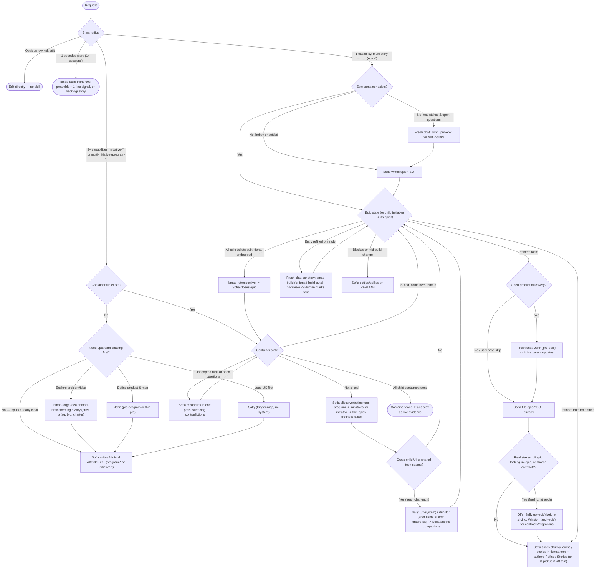

# BMad Method knowledge

This document covers the skills of the `method` module: what each one gives the user, when to recommend it, and what to offer next.

## How the method works

BMad v7 organizes work as one **Intent-Spec Tree** across three everyday altitudes (`Story -> Epic -> Initiative`), with an optional `Program` umbrella above them when a larger goal, theme, or program spans multiple initiatives. Enter at the lowest altitude whose blast radius contains the work, and promote upward only if hidden coupling surfaces.

**Any intent feeds Sofia's Minimal Altitude SOT.** Whether the input is a PRD, BRD, brief, PRFAQ, UX design, `bmad-ingest` transcript, or plain notes, Sofia (`bmad-agent-po`) owns the `program-*.md`, `initiative-*.md`, or `epic-*.md` spec at that altitude.

Downstream skills read the ticket first and in full, loading linked `companions:` where the ticket points and re-reading `sources:` only when Sofia updates the spec. A sharded document is passed by its main file named after its folder. The method also ships note templates for `standup`, `retrospective` (the meeting, not `bmad-retrospective`), `sprint-review`, `discovery-workshop`, and `user-interview`.

**Recommend across all installed modules.** Combine what `knowledge.py` and `list_templates.py` surface — including custom org templates and other modules such as Test Architect (TEA) or organization `bmod` extensions — and say plainly when a step has no installed skill.

**Default to fresh-chat handoffs.** Agents never load another specialist skill inline; every handoff gives one primary recommendation (plus zero to two relevant installed alternatives) and advises starting a fresh chat or compacting before continuing.

The four phases — analysis, planning, implementation, and validation — are capabilities, not a mandatory conveyor belt. Blast radius decides the altitude, and stakes decide how deep the planning goes.

## More detail

This document routes and names next steps. Read a topic file below only when the user asks about that subject, using the path `knowledge.py` lists for it.

| Topic file | Read when the user asks about |
|---|---|
| `help/altitudes.md` | Why v7 uses four altitudes, the fractal Intent-Spec Tree, the Coupling Test, upward promotion and ripples, Spec vs Ticket vs Refined Story vs Build Plan, tiered OKRs/invariants, and Mary's upstream role. |
| `help/analysis-skills.md` | The brief or the PRFAQ from Mary (`bmad-agent-analyst`) in depth: what each gives, when to pick it, when not to, how they relate, and her other documents. |
| `help/planning-skills.md` | `bmad-agent-po` (Sofia), `bmad-agent-pm` (John), `bmad-agent-ux-designer` (Sally), and `bmad-agent-architect` (Winston) in depth, plus customizing facilitated templates. |
| `help/implementation-skills.md` | `bmad-build` or `bmad-build-auto` in depth. |
| `help/validation-skills.md` | `bmad-code-review`, `bmad-walkthrough`, `bmad-qa-generate-e2e-tests`, or `bmad-retrospective` in depth. |
| `help/prototyping.md` | Prototyping or vibe coding first, what a prototype proves, non-engineers prototyping, and whether to throw away or keep a prototype. |
| `help/existing-codebase.md` | Using BMad on an inherited, brownfield, or long-lived codebase. |
| `help/preparing-a-repo-for-agents.md` | Getting a codebase ready for agentic coding, inconsistent agent output, keeping documentation small (ADRs), and regular refactoring. |
| `help/artifact-lifetime.md` | Keeping PRDs, specs, stories, and build plans after delivery, archiving, closing out an epic, and keeping old plans from misleading agents. |
| `help/monorepo-and-polyrepo.md` | Installing BMad and storing planning across one repository or a polyrepo workspace. |
| `help/working-in-an-organization.md` | A team or enterprise: an existing PRD, Jira or another tracker, approvals, single-owner docs, parallel engineers, and mid-flight requirement changes. |
| `help/ticketing-and-epics.md` | The fractal ticket tree (`program-*`, `initiative-*`, `epic-*`), `tickets.toml`, Refined Stories, plan status, review, and retrospective. |
| `help/ticketing-setup.md` | Setting up and driving the ticket tree with Sofia: store config, trackers, common phrases, and hand-off to `bmad-build`. |
| `help/unattended-builds.md` | `bmad-build-auto`, building stories unattended, blocked runs, retries, and post-run checks. |
| `help/review-choices.md` | Review depth, skipping review, extra review passes, when to stop, slow reviews, and customizing review. |
| `help/project-context.md` | `bmad-project-context` in depth: what belongs in `AGENTS.md`, why the block stays small, intents, and removing rules. |

## Which level

Altitude comes from blast radius, never from team size or session count. When genuinely unsure between two adjacent levels, start at the lighter one and promote upward if coupling surfaces.

| Blast radius | Altitude | Primary path | Written by |
|---|---|---|---|
| Obvious typo, config, or line-by-line edit | Direct edit | Edit directly (no skill) | Human / coding agent |
| One bounded story (one or more build sessions) | **Story** | `(Story ->) bmad-build` (bring a `backlog/` story or start inline with Amelia's 60s micro-preamble + 1-line success signal) | `bmad-build` (or Sofia for `backlog/`) |
| One cohesive capability spanning multiple stories | **Epic** (`epic-<slug>/`) | Real stakes & open discovery: `prd-epic` (auto Mini-Spine); hobby or already settled: Sofia directly | John (`prd-epic`) then Sofia (`epic-*.md`) |
| Two or more capabilities sharing outcomes, invariants, or nouns | **Initiative** (`initiative-<slug>/`) | Thin Spine `prd` (+ optional `ux-system`, `arch-spine`) then Sofia; or Sofia directly if settled | John (`prd`) then Sofia (`initiative-*.md`) |
| Multiple initiatives serving one larger goal, theme, or program | **Program** (`program-<slug>/`, optional) | Loosely coupled goal/theme: Mary (`narrative` or `charter`) + Sofia (`program-*` rollup), skipping `arch-enterprise`; technically coupled waves: John (`prd-program`) + Winston (`arch-enterprise`) | John (`prd-program`), Mary (`narrative`/`charter`), Sofia (`program-*.md`) |

A project's `core.active_initiative` can point directly at any top-level container (`program-*`, `initiative-*`, or standalone `epic-*`).

## Routing

Every "what next" reads the active container's state (`program-*`, `initiative-*`, or `epic-*`) across installed modules.

Rules the routing rests on:

- Upstream shaping skills feed each other or Sofia's SOT directly; Sally (`bmad-agent-ux-designer`) may lead UX-first before any PRD.
- A prototype fits anywhere before committing (`help/prototyping.md`); keep thrown-away notes or an existing prototype as input to Sofia.
- Keep specialists in fresh chats: Sofia never invokes John, Sally, or Winston inline and never invents product or UX discovery answers.
- Single-story work stays a story, even when it takes two build sessions; an epic holds one story only when already inside an initiative or when discovery/architecture requires an epic container.
- Mid-path, resume at the earliest affected step without replaying unaffected work; other installed modules (such as TEA test planning or org `bmod` extensions) slot in wherever their own `help.md` applies.
- Work finishes when the intent is satisfied, chosen checks pass, and no material review findings remain open — not when every skill has run.

## Match the situation

| The user says or has | Recommend | Because |
|---|---|---|
| One bounded feature or tool needing two build sessions | `(Story ->) bmad-build` | Session count never forces an initiative; Amelia runs a 60s micro-preamble + 1-line success signal inline and promotes only if coupling surfaces. |
| One capability needing a few stories, no multi-epic initiative | `epic-<slug>/`: John (`prd-epic`) for real stakes, or Sofia directly for hobby/settled | Standalone top-level epics include an auto Mini-Spine Preamble and lift cleanly into an initiative later if needed. |
| Work spans multiple initiatives serving one goal, theme, or program | `program-<slug>/`: Mary (`narrative` or `charter`) + Sofia (`program-*`) when initiatives are independent; John (`prd-program`) + Winston (`arch-enterprise`) when initiatives share cross-domain seams | Scales by coupling rather than company size: independent initiatives share an outcome rollup without enterprise architecture, while coupled waves coordinate contracts and rollout. |
| "Create a spec", "write the initiative", "distill this PRD", "slice this", "what's ready", "replan", "ask Sofia" | Sofia (`bmad-agent-po`) | Dispatches to her capabilities (SPEC, TICKETS, REFINE, BOARD, VALIDATE, REPLAN, STORE); asked, she lists them. |
| "Create/update/validate a PRD", "draft the program charter", "shape a pitch", "plan the launch", "ask John" | John (`bmad-agent-pm`) | Coaches, updates, or validates product documents across `prd-program`, `prd`, `prd-epic`, `srs`, `pitch`, `launch`, `prototype-plan`, `charter`, and `experiment`. |
| "Write a brief", "create a PRFAQ", "write the BRD", "business case", "strategy narrative", "market research", "ask Mary" | Mary (`bmad-agent-analyst`) | Runs BRAINSTORM, RESEARCH, and CONTEXT, and facilitates upstream analysis docs (`brief`, `prfaq`, `opportunity`, `business-case`, `narrative`, `brd`, `charter`, `experiment`, `trigger-map`). |
| "Design the UX", "brand identity", "DESIGN.md", "EXPERIENCE.md", "wireframes", "audit this UI", "ask Sally" | Sally (`bmad-agent-ux-designer`) | Facilitates `trigger-map`, `brand-identity`, `design-direction`, `ux-system`, `ux-epic`, `ux-quick`, `website-design`, and `ux-audit`, plus mockups and Figma/Stitch/Claude Design handoffs. |
| "Architecture", "arch-spine", "epic tech design", "RFC", "build vs buy", "agent readiness", "ADR", "ask Winston" | Winston (`bmad-agent-architect`) | Facilitates `arch-enterprise`, `arch-spine`, `arch-epic`, `solution-design`, `tech-evaluation`, `api-design`, `agent-readiness`, `migration-plan`, `production-readiness`, `decision-record`, `postmortem`, and `security-review`. |
| "How should I build this", "review depth", "retry blocked ticket", "run the epic unattended", "ask Amelia" | Amelia (`bmad-agent-dev`) | Guides `bmad-build`, `bmad-build-auto`, `bmad-code-review`, `bmad-walkthrough`, and `bmad-retrospective`. |
| One standalone bug or story to track outside an epic | Sofia (`bmad-agent-po`) for `backlog/`, or an entry in a named epic | Standalone leaves live in `backlog/` and build like any story. |
| Work spans several repositories | Install BMad at the workspace root above them | One session reaches the ticket tree and every project (`help/monorepo-and-polyrepo.md`). |
| Inherited codebase or preparing a repo for AI agents | Small `bmad-build` change first; `bmad-project-context`, `bmad-walkthrough`, Winston `agent-readiness` | Clean patterns and a lean `AGENTS.md` beat heavy upfront docs (`help/existing-codebase.md`, `help/preparing-a-repo-for-agents.md`). |
| Existing PRD, external tracker, approvals, or parallel engineers | Full path + single-owner docs when approvers or parallel seams require it | See `help/working-in-an-organization.md` and `help/ticketing-setup.md`. |
| A v6 project (`epics.md`, `sprint-status.yaml`) or pre-`tickets/` v7 layout | `bmad migrate method` before anything else | `migration-1.toml` moves v6 artifacts into an initiative; `migration-2.toml` nests breakdowns under `tickets/`. |

## The skills

Paths resolve under `{output_folder}/{active_initiative}/` (where `active_initiative` holds any top-level `program-*`, `initiative-*`, or `epic-*` container), or `{output_folder}/` when none is active. Each facilitated run creates a `<type>-<slug>/<type>-<slug>.md` folder, and epic-level runs land inside their epic (`<epic>/<template id>-<slug>/`).

Standalone skills — Winston's technical docs, Sally's branding/websites/audits/quick UX, Mary's pre-commitment docs, `bmad-build`, and `bmad-agent-po` container creation — work without an active initiative. Managing `active_initiative` is a `bmad` command; `planning_artifacts` and `implementation_artifacts` are obsolete.

| Skill | For | Writes |
|---|---|---|
| **Analysis** (`help/analysis-skills.md`) | | |
| `bmad-agent-analyst` | Mary brainstorms and researches (`bmad-deep-recon`), then facilitates `brief`, `prfaq`, `opportunity`, `business-case`, `narrative`, `brd` (plus `trigger-map` with Sally, and `charter`/`experiment` with John). | `<id>-<slug>/<id>-<slug>.md` |
| **Planning** (`help/planning-skills.md`) | | |
| `bmad-agent-po` | Sofia owns Minimal Altitude SOT (`program-*`, `initiative-*`, `epic-*`), single-pass `unadopted_runs` reconciliation, contradiction arbitration, scoped slicing (verbatim PRD maps, chunky journey stories), design-linked `tickets.toml` entries, inception Refined Stories, board, validate, replan, and trackers. | Container `.md`, `.memlog.md`, `tickets/tickets.toml`, `story-<slug>.md`, `{output_folder}/backlog/` |
| `bmad-agent-pm` | John facilitates `prd-program`, `prd`, `prd-epic`, `srs`, `prototype-plan`, `pitch`, `launch` (plus `charter` and `experiment` with Mary), as well as updates and read-only validation. | `<id>-<slug>/<id>-<slug>.md` |
| `bmad-agent-ux-designer` | Sally facilitates `trigger-map`, `brand-identity`, `design-direction`, `ux-system`, `ux-epic`, `ux-quick`, `website-design`, and `ux-audit`, plus creative HTML mockups and Stitch/Claude Design/Figma handoffs. | `<id>-<slug>/` (or `branding/`) with `DESIGN.md`, `EXPERIENCE.md` / `BRAND.md`, mockups, `<id>-<slug>.md` |
| `bmad-agent-architect` | Winston facilitates `arch-enterprise`, `arch-spine`, `arch-epic` (+ `contract.yaml`), `solution-design`, `tech-evaluation`, `api-design`, `agent-readiness`, `migration-plan`, `production-readiness`, `decision-record`, `postmortem`, and `security-review`. | `<id>-<slug>/<id>-<slug>.md` |
| **Implementation** (`help/implementation-skills.md`) | | |
| `bmad-build` | Delivery session: clarifies (60s micro-preamble + 1-line signal when standalone), walks parent contracts (`DESIGN.md`, `EXPERIENCE.md`, mockups, architecture) into `context:`, keeps every Refined Story AC covered in the plan, implements, reviews, and commits. | `story-<slug>-plan.md` beside `tickets.toml` (or in `backlog/`), `plan-<slug>.md`, `deferred-work.md` |
| `bmad-build-auto` | Unattended single-ticket build for loops/scripts (or approved prototype plans), walking the same parent contracts and halting `blocked` on any intent gap. | Same plan paths as `bmad-build` |
| **Validation** (`help/validation-skills.md`) | | |
| `bmad-code-review` | Agent review of any diff, PR, branch, or `in-review` ticket with verified, triaged findings (redundant right after a thorough `bmad-build` review). | Dated block in plan's `## Code Review` section, or chat |
| `bmad-walkthrough` | Guided block-by-block human walkthrough of a commit, PR, file, or directory. | `walkthrough-<slug>/` narrative and log |
| `bmad-qa-generate-e2e-tests` | API and end-to-end tests for existing features following the project's test harness. | E2E tests in project test dir; report in chat |
| `bmad-retrospective` | Evaluates a finished epic folder against its `Done when` across all tickets and plans. | `epic-<slug>-retrospective.md` and approved `adr-<slug>.md` files |
| **Any time** (`help/project-context.md`) | | |
| `bmad-project-context` | Maintains a small, verified rules block in `AGENTS.md` (not a repo overview). | `{project-root}/AGENTS.md` |

### Who reviews what

| | Reviewer | Looks at | Fixes |
|---|---|---|---|
| Review inside `bmad-build` | Agents | The change just built | Clear findings, itself |
| `bmad-code-review` | Agents | Any diff, PR, branch, or commit | What the human chooses |
| `bmad-walkthrough` | The human, guided | A commit, PR, file, or directory | Nothing unless asked |
| `bmad-retrospective` | Agents, across tickets | A whole epic folder | Nothing; proposes action items |

## The agents

Six named experts owning phases across conversations. Offer an agent whenever the user wants a thinking partner rather than a single skill, or wants to converse across turns before and between skill runs.

| Agent | Phase | Work with them to |
|---|---|---|
| Mary, analyst — `bmad-agent-analyst` | Analysis | Brainstorm, run `bmad-deep-recon`, and decide whether and why to build (`brief`, `prfaq`, `opportunity`, `business-case`, `narrative`, `brd`, `trigger-map`, `charter`, `experiment`). |
| John, product manager — `bmad-agent-pm` | Planning | Shape product contracts by altitude (`prd-program`, `prd`, `prd-epic`, `srs`, `pitch`, `launch`, `prototype-plan`, `charter`, `experiment`). |
| Sofia, product owner — `bmad-agent-po` | Planning | Reconcile any intent into `program-*`/`initiative-*`/`epic-*` SOT, slice verbatim maps and chunky stories, refine stories, run the board, and replan mid-flight. |
| Sally, UX designer — `bmad-agent-ux-designer` | Planning | Shape user psychology, brand kits, visual direction, `DESIGN.md`/`EXPERIENCE.md`, key-screen mockups, websites, and UI audits. |
| Winston, architect — `bmad-agent-architect` | Planning | Settle technical boundaries (`arch-enterprise`, `arch-spine`, `arch-epic`), RFCs, bake-offs, APIs, readiness, migrations, ADRs, and security/postmortem docs. |
| Amelia, developer — `bmad-agent-dev` | Implementation and validation | Choose the build or review depth, troubleshoot blocked runs, and run ready tickets unattended. |

`bmad-party-mode` brings installed agents together in one discussion and offers the `product-team` room.

## When this document is not enough

For a `method` question this document, its topic files, and installed skills cannot answer, fetch `https://docs.bmad-method.org/` and follow the relevant pages; the linked source repository is the final authority on actual behavior.
